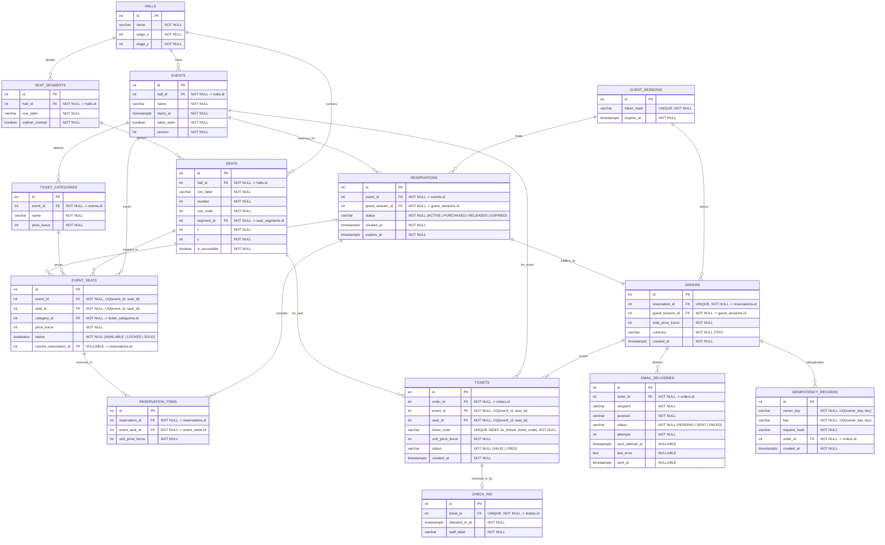

# Event Ticketing ve Koltuk Seçimi — Birinci Aşama (S1) ER Diyagramı

Aşağıdaki Mermaid ER diyagramı projenin Birinci Aşama (S1) veri modelini, fiziksel koltuk (`SEATS`) ile etkinlik bazlı doluluk (`EVENT_SEATS`) ayrımını, süreli rezervasyon (`RESERVATIONS`), sipariş (`ORDERS`), bilet (`TICKETS`), tek kullanımlık QR giriş (`CHECK_INS`), e-posta teslim kuyruğu (`EMAIL_DELIVERIES`) ve tekrar istek korumasını (`IDEMPOTENCY_RECORDS`) göstermektedir.

