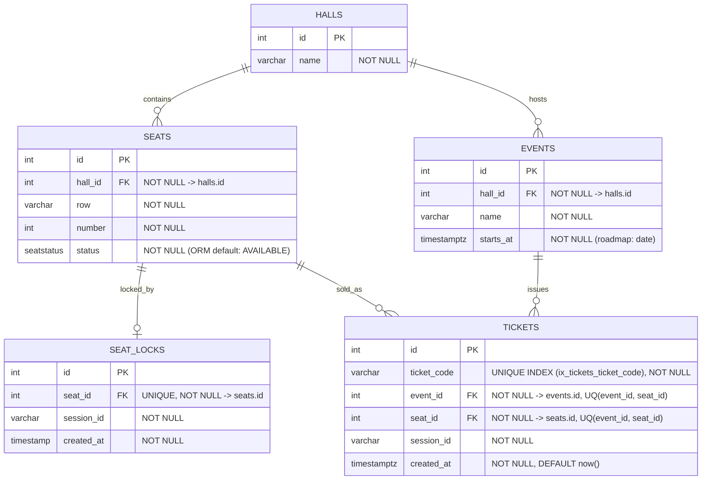

# Event Ticketing ve Koltuk Seçimi — ER Diyagramı

Aşağıdaki Mermaid ER diyagramı projenin tek salon ve tek etkinlik prototipindeki beş ana tabloyu (`halls`, `seats`, `seat_locks`, `events`, `tickets`), birincil/yabancı anahtarları ve tekillik kısıtlarını/indekslerini göstermektedir.

## Kısıt, İndeks ve Varsayılan Değer Özeti

| Tablo | Kısıt / İndeks Adı | Kapsam | Açıklama |
|---|---|---|---|
| `halls` | `halls_pkey` (PK), `ix_halls_id` | `id` | Salon birincil anahtarı |
| `seats` | `seats_pkey` (PK), `seats_hall_id_fkey` (FK) | `id`, `hall_id -> halls(id)` | `status` sütunu veritabanında `NOT NULL` olup varsayılan değer (`SeatStatus.AVAILABLE`) SQLAlchemy ORM katmanında atanır |
| `seat_locks` | `seat_locks_seat_id_key` (UNIQUE) | `seat_id` | Aynı koltuk için aynı anda yalnızca tek aktif kilit bulunması |
| `events` | `events_pkey` (PK), `events_hall_id_fkey` (FK) | `id`, `hall_id -> halls(id)` | Etkinliğin düzenlendiği salon ve saat dilimi duyarlı başlangıç zamanı (`starts_at`) |
| `tickets` | `ix_tickets_ticket_code` (UNIQUE INDEX) | `ticket_code` | Hem ORM (`unique=True, index=True`) hem SQL şema dosyalarında tek ve tekrarsız unique index olarak tanımlanmıştır |
| `tickets` | `uq_tickets_event_seat` (UNIQUE CONSTRAINT) | `(event_id, seat_id)` | Aynı etkinlik ve aynı koltuk için birden fazla bilet kesilmesini veritabanı seviyesinde kesin olarak engeller |
